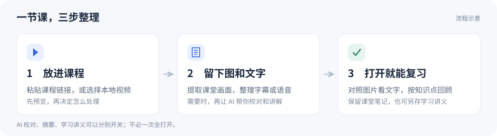
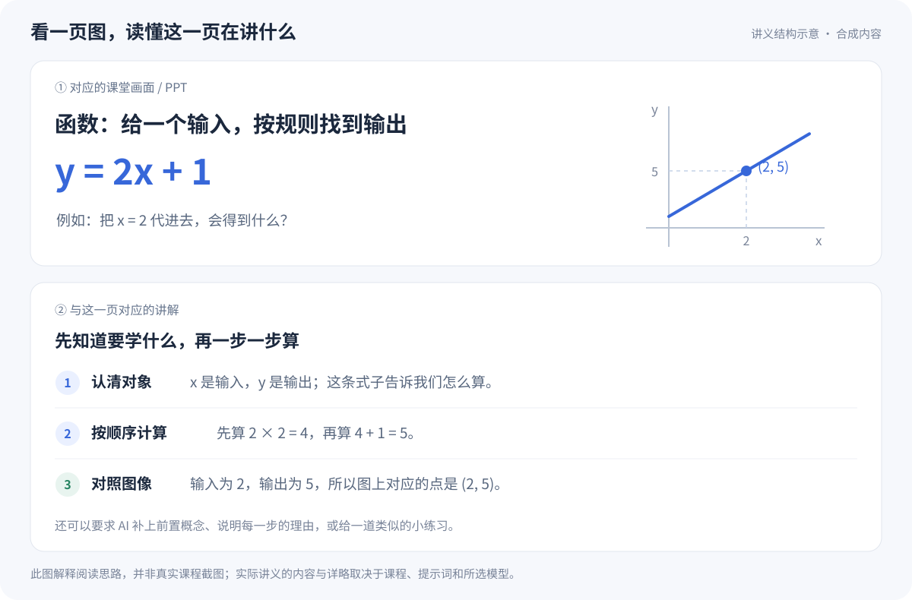

# 视频转笔记

**AI 网课学习助手：上面看 PPT，下面读讲解。**

Course2MD Learning · Video to Notes & AI Study Guides

[获取源码](#download) · [让 AI 帮我配置](#agent-setup) · [第一次使用](#first-use) · [开发文档](docs/DEVELOPMENT.md)

看课时听懂了，复习时却想不起老师在哪一页讲过？这个工具会从课程里
提取画面，把字幕或讲课声音整理成文字。支持 Bilibili、YouTube 和本地
视频；你可以对着 PPT 截图看讲解，也可以让 AI 按你的要求，再整理成
一步一步的学习讲义。适合自学网课、补课和考前复习。

基于 [mizorewww/course2md](https://github.com/mizorewww/course2md) 二次开发，
保留原作者署名与 MIT 许可证，非官方发行版。



## 它能帮你做什么？

- **把图和讲解放在一起。** 复习时，对照课堂画面看对应文字。
- **少读一点废话。** 按需开启校对，修正识别错误、删掉无意义的语气词。
- **把“老师说过什么”变成“我该怎么理解”。** 开启学习讲义，让 AI 解释
  概念、展开步骤，也可以按你的要求补充例子和练习。
- **按自己的方式整理。** AI 服务、模型和教学提示词都可以选择，课堂
  笔记与 AI 讲义分别保留。

“转录”就是把讲课声音变成文字；“学习讲义”则会在文字基础上进一步
整理和解释。两者不是同一件事。



*图片使用专门编写的合成内容，说明阅读方式，不是真实课程截图或实际 AI 生成结果。*

<a id="download"></a>

## 下载与开始

**目前提供源码，尚未发布本修改版的安装包。** 下载 ZIP 是拿到代码，
还需要准备环境、构建后才能运行。不会配环境，可以把下面的要求交给
能操作本机终端的 AI 编程助手。

| 你想怎么开始 | 从这里进入 |
| --- | --- |
| 让 AI 帮忙下载、配置 | [复制给 Agent 的要求](#agent-setup) |
| 自己手动下载 | [下载源码 ZIP](https://github.com/evanielyforquilhinha-hub/course2md-learning/archive/refs/heads/main.zip)，解压后看 [下载与配置教程](docs/INSTALL.md) |
| 用 PowerShell 或 Git 获取 | [查看命令和下一步](docs/INSTALL.md#commands) |

已经装好 Git？在你想存放项目的文件夹打开终端，运行：

```powershell
git clone https://github.com/evanielyforquilhinha-hub/course2md-learning.git
```

看到新建的 `course2md-learning` 文件夹后，按 [构建与启动步骤](docs/DEVELOPMENT.md)
继续。模型、FFmpeg 等运行依赖与个人账号配置，需要另外准备。

<a id="agent-setup"></a>

### 给 AI 编程助手的一段话

复制下面这段话，发给能读写本地文件、运行终端命令的 AI 编程助手：

```text
请帮我在本机配置“视频转笔记”：
https://github.com/evanielyforquilhinha-hub/course2md-learning
先确认保存目录，在新目录下载源码，阅读 AGENTS.md、docs/INSTALL.md
和 docs/DEVELOPMENT.md；按我的系统检查依赖、构建并用隔离配置启动。
不要覆盖已有项目或导入私人账号资料，不要调用付费 AI。
遇到需要我操作的步骤请说明；最后告诉我启动方法、文件位置，
以及哪些步骤已实际验证。
```

普通网页聊天不能直接替你安装软件。完整的环境要求、手动步骤和常见
问题在 [下载与配置教程](docs/INSTALL.md)。

<a id="first-use"></a>

## 第一次怎么用？

程序启动后，按这三步操作：

### 1. 添加一节课

进入“添加课程”，粘贴 YouTube / Bilibili 课程链接，或选择本地视频。
在线课程先预览，确认是你要处理的内容。

### 2. 选好这次要怎么整理

右侧“处理选项”决定这节课怎么处理。第一次可以先生成普通笔记，
确认图和文字能正常出来，再根据需要开启 AI。

| 选项 | 用通俗的话说 | 你会得到什么 |
| --- | --- | --- |
| 普通图文笔记 | 留下画面和课堂文字 | 按课堂顺序排列的截图与字幕或转录 |
| 文字校对 | 把明显的错字、断句和口头填充整理一下 | 更顺畅的课堂文字，尽量保留原意 |
| 开头摘要 | 先告诉我这节课讲了什么 | 一段概述、几个要点和时间大纲 |
| AI 学习讲义 | 像写教材一样，把这一页讲清楚 | 结合截图的概念解释、步骤和练习 |

后三项可以分别开关。**关掉学习讲义，不等于关掉文字校对或摘要。**

如果想用 AI，先在“设置 → 服务与账号”配置服务，再回到添加课程页
选择本次使用的服务和模型。API Key 是服务商给你的访问凭证，可以把它
理解成“调用模型的钥匙”，不要分享给别人。

### 3. 开始转换，完成后打开笔记

确认选项后点击“开始转换”，在任务里查看进度。普通笔记生成后即可
阅读；如果开启了学习讲义，还会继续完成 AI 整理。生成过的讲义可以
直接打开，需要重做时再主动选择“重新生成”。

## 提示词可以自己改吗？

可以。**提示词就是你交给 AI 的整理要求**，不需要学会写程序。
例如，你可以这样要求：

> 我是第一次学这一章。先解释必要的概念，再按顺序讲例题。
> 每一步说清“做什么、为什么这样做、得到什么”，不要跳过关键推导。

在设置里修改默认教学提示词，后面的新课程就能沿用；添加课程时也能
只修改这一次的要求。已有讲义不会因为修改默认值而自动重写。

## 使用前，了解这几件事

- **AI 是可选的。** 不开启文字校对、摘要和学习讲义，也能通过字幕或
  语音识别生成普通笔记。语音识别方式需要单独选择。
- **费用看你选的服务。** 软件可连接 OpenAI 兼容 API、本地 Ollama 和
  现有的 Codex 订阅通道；可用模型、额度与费用以对应服务为准。
- **公式也需要核对。** 学习讲义支持公式排版，但识别和 AI 都可能出错，
  重要符号、题目条件和推导请对照原图检查。
- **公开仓库不放私人资料。** 本仓库不包含个人课程、笔记、账号凭据
  或私人提示词。使用在线 AI 时，相关文字和图片会发给你选择的服务。

## 想了解更多？

- [下载与配置教程](docs/INSTALL.md)：AI 协助、手动下载、PowerShell 和 Git 四种入口。
- [开发、启动与测试](docs/DEVELOPMENT.md)：从源码构建程序的完整步骤。
- [仓库目录说明](docs/REPOSITORY_GUIDE.md)：每个文件夹放什么，哪些资料不该提交。
- [讲义工具说明](03_工具/学习讲义生成器/README.md)：教学模板、公式排版和测试。

感谢原项目 [mizorewww/course2md](https://github.com/mizorewww/course2md)。
原版说明保留在 [README.upstream.md](README.upstream.md)，其中的安装包
链接属于上游版本。来源与修改说明见 [NOTICE](NOTICE.md)，授权见
[MIT License](LICENSE) 和 [第三方许可说明](THIRD_PARTY_NOTICES.md)。

如果这个工具帮到了你，欢迎点个 Star；遇到问题，可以在
[Issues](https://github.com/evanielyforquilhinha-hub/course2md-learning/issues)
告诉我们你在哪一步卡住了。提交截图和日志前，请遮住账号、密钥和私人课程内容。
